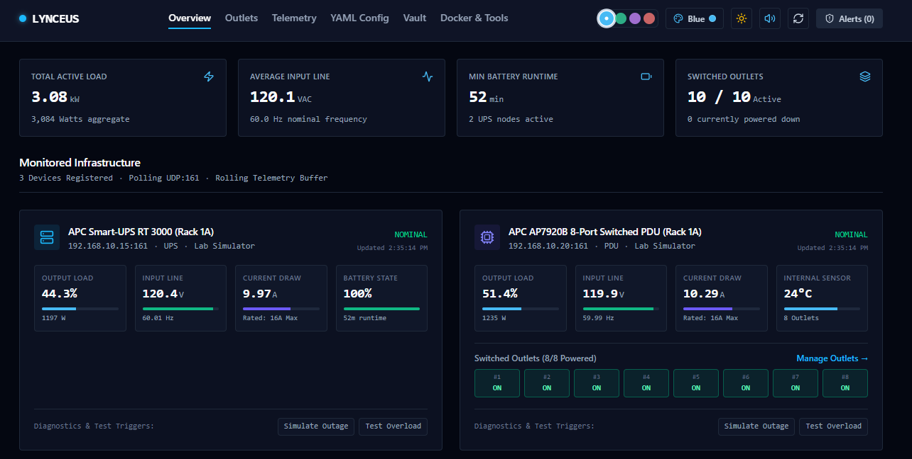
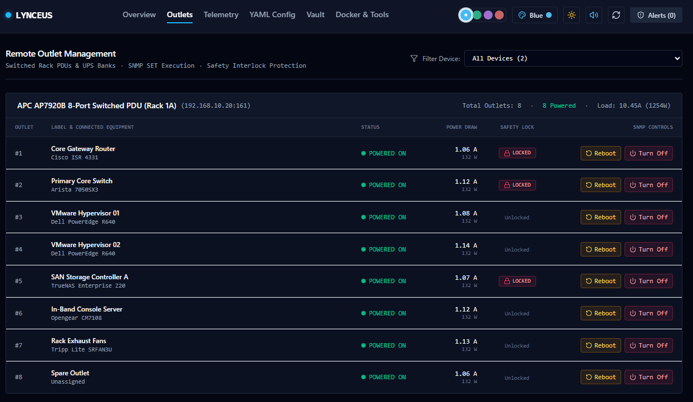
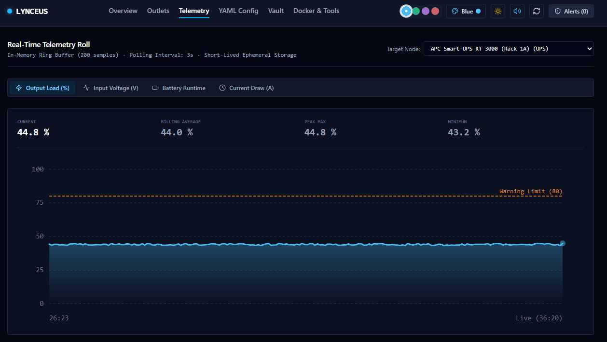
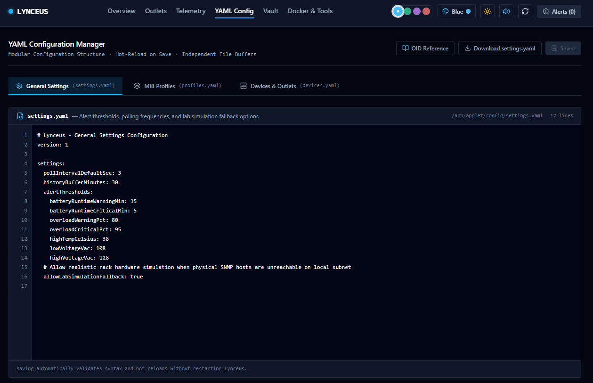
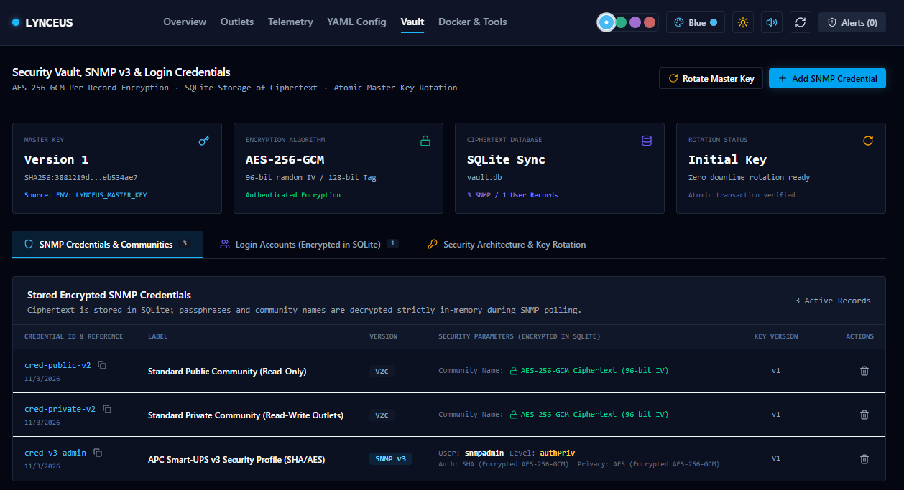
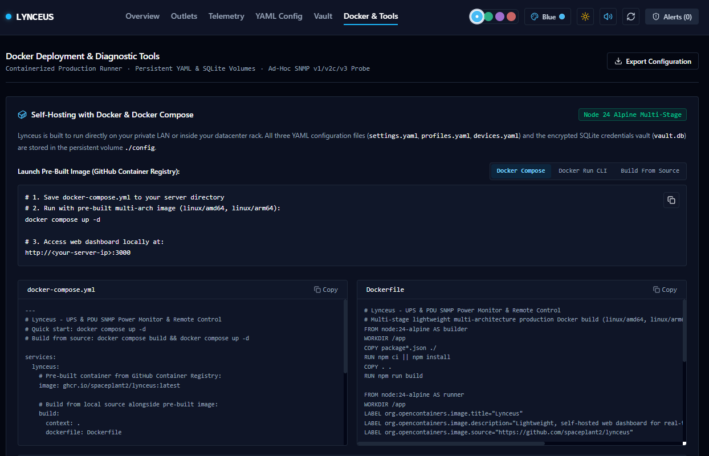

# Lynceus 
## UPS & PDU SNMP Power Dashboard

Lynceus is a lightweight, self-hosted web dashboard designed for private local networks, homelabs, and datacenter racks to monitor and manage UPSs (Uninterruptible Power Supplies) and PDUs (Power Distribution Units) via SNMP.

The dashboard features a general overview of power consumption and battery charge as well as individual outlet toggling and toggle locking. Short-term telemetry visualizations are created, but this project is focused on management not on data tracking. For longer term datatracking, I suggest Prometheus.

Configuration can be done either through the GUI editor or directly in the configuration files. Syntax is automagically validated when the GUI editor is used and the container will reload when it see changes.

SNMP communities and passwords are kept encrypted at rest and a built-in automation for rotating the master encryption key is available.

Ad-Hoc queries are possible from the tools page, allowing for initial exploration of targets. Also an API is available and a reference is available.

#### Contents

[Quick Start Guide](README.md#quick-start-with-docker)

[Setup guide](README.md#guide-adding--modifying-snmp-communities--credentials)

[Important Notes](README.md#important-network--firewall-notes)

[Key Features](README.md#key-dashboard-features)

[API Reference](API_REFERENCE.md)

[Version Tracking](README.md#technologies-dependencies--version-tracking)

[Dependencies Matrix](DEPENDENCIES.md)

[Local Development](README.md#local-development-without-docker)

---

### Screenshots of the dashboard in simulation mode

Click on the arrows to show or hide the screenshots.

<details>
  <summary>Overview Dashboard</summary>
  
</details>
<details>
  <summary>Outlets Dashboard</summary>
  
</details>
<details>
  <summary>Telemetry Dashboard</summary>
  
</details>
<details>
  <summary>Configuration Dashboard</summary>
  
</details>
<details>
  <summary>Vault Dashboard</summary>
  
</details>
<details>
  <summary>Docker & Tools Dashboard</summary>
  
</details>

---

## Quick Start with Docker

Lynceus is distributed as a lightweight, pre-built multi-architecture container image (`linux/amd64` and `linux/arm64`) hosted on GitHub Container Registry:

```
ghcr.io/spaceplant2/lynceus:latest
```

It can be deployed in the usual ways as well as built locally or installed on bare metal without docker.

---

### Option 1: Docker Compose (Local Build)

The repository's `docker-compose.yml` is configured for automating local builds after cloning the repository:

```yaml
---
services:
  lynceus:
    image: ghcr.io/spaceplant2/lynceus:latest

    # Build from local source alongside pre-built image support:
    # - Run 'docker compose up -d' to start with the pre-built image
    # - Run 'docker compose build' to build locally from Dockerfile
    # - Run 'docker compose up --build -d' to rebuild and start
    # - Run 'docker compose pull' to fetch the newest published image from GHCR
    build:
      context: .
      dockerfile: Dockerfile

    container_name: lynceus
    restart: unless-stopped
    ports:
      - "3000:3000"
    volumes:
      # Persistent configuration (YAML files) and encrypted SQLite vault (vault.db):
      - ./config:/app/config
    environment:
      - PORT=3000
      - NODE_ENV=production
      - CONFIG_DIR=/app/config
      # Optional master key for AES-256-GCM encryption of SNMP credentials and user accounts.
      # If omitted, a persistent key is automatically generated and secured in ./config/.master.key:
      # - LYNCEUS_MASTER_KEY=my-secure-master-passphrase

    # To enable direct subnet UDP SNMP queries without Docker bridge NAT, uncomment on Linux:
    # network_mode: host
```

**Commands:**
- **Run pre-built image**: `docker compose up -d`
- **Update to latest pre-built image**: `docker compose pull && docker compose up -d`
- **Build locally from source**: `docker compose build && docker compose up -d` (or `docker compose up -d --build`)

### Option 2: Docker Compose (Pre-Built)

The repository's `docker-compose.standalone.yml` is for pulling and running the pre-built container:
> This excludes the local `build:` section:
> ```bash
> curl -sSL https://raw.githubusercontent.com/spaceplant2/lynceus/main/docker-compose.standalone.yml -o docker-compose.yml
> curl -sSL https://raw.githubusercontent.com/spaceplant2/lynceus/main/.env.example .env
> docker compose up -d
> ```

---

### Option 3: Docker CLI One-Liner

Run directly using the pre-built image with a local persistent config folder:

```bash
docker run -d \
  --name lynceus \
  --restart unless-stopped \
  -p 3000:3000 \
  -v $(pwd)/config:/app/config \
  ghcr.io/spaceplant2/lynceus:latest
```

*(Optional: add `-e LYNCEUS_MASTER_KEY="your-secret"` to define an explicit master key).*

---

### Option 4: Standard Docker CLI Build

You can also build the image directly with the Docker CLI using the root `Dockerfile`:

```bash
docker build -t lynceus:latest .
docker run -d --name lynceus -p 3000:3000 -v $(pwd)/config:/app/config lynceus:latest
```

---

### Automated Multi-Architecture CI/CD  via GitHub Actions

Container images are automatically built and published to GitHub Container Registry using the included GitHub Actions workflow (`.github/workflows/docker-publish.yml`):
- **Architectures**: Multi-arch support for `linux/amd64` (Intel/AMD x86_64 servers) and `linux/arm64` (Raspberry Pi 4/5, Apple Silicon, ARM64 homelab SBCs).
- **Triggers**:
  - Pushes to the `main` branch automatically build and tag `ghcr.io/spaceplant2/lynceus:latest` and the short commit SHA.
  - Tagged Git releases (e.g. `v1.0.0`) automatically publish corresponding version tags (`1.0.0`, `1.0`, `1`, `latest`).
  - Manual triggers are supported via GitHub Actions **Run workflow** (`workflow_dispatch`).
- **Zero-Setup Authentication**: Uses GitHub's built-in `GITHUB_TOKEN` permissions (`packages: write`), requiring no third-party account keys or Docker Hub credentials.

---

## Guide: Adding & Modifying SNMP Communities & Credentials

Lynceus supports **SNMP v1**, **SNMP v2c**, and **SNMP v3** (User-based Security Model with `authPriv`, `authNoPriv`, and `noAuthNoPriv`).

Credentials can be managed through two methods:
1. **Encrypted SQLite Vault (Recommended)**: Passphrases and communities are encrypted at rest with **AES-256-GCM** (unique 96-bit random IV per record) in `config/vault.db` and decrypted strictly in memory when polling.
2. **Direct YAML Configuration**: Stored directly in `config/devices.yaml`.

---

### Method 1: Using the Encrypted SQLite Vault (Recommended)

#### 1. Adding an SNMP Community or v3 Profile via the Web UI
1. Navigate to the **Vault** tab in the top navigation bar.
2. Click the **"Add SNMP Credential"** button in the top right.
3. Fill out the dialog:
   - **Unique Credential ID**: A unique reference name, e.g., `cred-datacenter-v2` or `cred-apc-v3`.
   - **Description / Label**: A human-friendly title, e.g., `Rack 1A Switched PDU Private Community`.
   - **SNMP Protocol Version**: Choose between `SNMP v2c (Community)`, `SNMP v1`, or `SNMP v3 (Encrypted USM)`.
4. Specify authentication parameters:
   - **For SNMP v1 / v2c**: Enter the Community String (e.g., `public` for read-only or `private` for switched outlet reboot control).
   - **For SNMP v3**:
     - **Username**: USM security username (e.g., `snmpadmin`).
     - **Security Level**:
       - `authPriv`: Authenticated and encrypted (Recommended).
       - `authNoPriv`: Authenticated without privacy/encryption.
       - `noAuthNoPriv`: No authentication or privacy.
     - **Auth Protocol & Key**: Select `SHA` (recommended) or `MD5`, then enter the auth passphrase.
     - **Privacy Protocol & Key**: Select `AES` (recommended) or `DES`, then enter the privacy passphrase.
     - **Context Name**: Optional context string (e.g., `vlan100` or leave empty).
5. Click **"Save Encrypted Credential"**.
   - The credential is encrypted with AES-256-GCM and stored in `config/vault.db`.
   - The polling engine immediately detects the update with zero downtime.

#### 2. Referencing the Encrypted Credential in `config/devices.yaml`
In the **YAML Config** tab (or directly in `./config/devices.yaml`), map the device using `credentialId`:

```yaml
devices:
  # SNMP v2c device referencing encrypted community name
  - id: pdu-rack-alpha
    name: "APC AP7920B 8-Port Switched PDU"
    type: pdu
    host: "192.168.10.20"
    port: 161
    snmpVersion: "2c"
    credentialId: "cred-private-v2"  # Resolves encrypted AES-256-GCM community from SQLite vault
    profile: apc-switched-pdu

  # SNMP v3 device referencing encrypted USM credentials
  - id: ups-datacenter-01
    name: "APC Smart-UPS RT 3000"
    type: ups
    host: "192.168.10.15"
    port: 161
    snmpVersion: "3"
    credentialId: "cred-v3-admin"    # Resolves encrypted SHA/AES credentials from SQLite vault
    profile: apc-powernet-ups
```

#### 3. Modifying an Existing Credential
- To update an existing credential's passkey or community string:
  1. Open **"Add SNMP Credential"**.
  2. Enter the same **Credential ID** as the existing record.
  3. Enter the updated community or v3 passphrases.
  4. Click **"Save Encrypted Credential"**. Lynceus atomically updates and re-encrypts the record with a fresh random IV.
- To delete an outdated credential, click the **Trash** icon next to the record in the Vault table.

#### 4. Managing Credentials via the REST API
You can also automate credential provisioning via curl or configuration scripts:

```bash
# Create or update an SNMP v2c community
curl -X POST http://localhost:3000/api/vault/credentials \
  -H "Content-Type: application/json" \
  -d '{
    "id": "cred-core-switch",
    "label": "Core Switch Community",
    "snmpVersion": "2c",
    "community": "s3cr3tComm"
  }'

# Create or update an SNMP v3 USM profile (AuthPriv SHA/AES)
curl -X POST http://localhost:3000/api/vault/credentials \
  -H "Content-Type: application/json" \
  -d '{
    "id": "cred-datacenter-v3",
    "label": "UPS Datacenter v3 Profile",
    "snmpVersion": "3",
    "v3Username": "snmpadmin",
    "v3SecurityLevel": "authPriv",
    "v3AuthProtocol": "sha",
    "v3AuthKey": "AuthPassword123!",
    "v3PrivProtocol": "aes",
    "v3PrivKey": "PrivPassword567!",
    "v3Context": ""
  }'

# List all stored credentials (secrets remain encrypted)
curl http://localhost:3000/api/vault/credentials

# Delete a credential
curl -X DELETE http://localhost:3000/api/vault/credentials/cred-core-switch
```

---

### Method 2: Direct YAML Configuration (`config/devices.yaml`)

If you prefer keeping credentials in text files rather than the SQLite vault, you can configure them directly in `config/devices.yaml`:

#### For SNMP v1 / v2c Community Strings:
```yaml
devices:
  - id: ups-server-room
    name: "Eaton 5PX 2200RT"
    type: ups
    host: "192.168.1.50"
    port: 161
    snmpVersion: "2c"
    community: "public"       # Community string directly in YAML
    pollIntervalSec: 3
    profile: rfc1628-ups
```

#### For Inline SNMP v3:
```yaml
devices:
  - id: ups-rack-02
    name: "APC Smart-UPS SRT 5000"
    type: ups
    host: "192.168.1.60"
    port: 161
    snmpVersion: "3"
    v3:
      username: "snmpadmin"
      securityLevel: "authPriv"    # 'noAuthNoPriv' | 'authNoPriv' | 'authPriv'
      authProtocol: "sha"          # 'sha' | 'md5'
      authKey: "YourAuthPassword"
      privProtocol: "aes"          # 'aes' | 'des'
      privKey: "YourPrivPassword"
      context: ""
    pollIntervalSec: 3
    profile: apc-powernet-ups
```

---

### Testing Credentials with the Built-In SNMP Probe

Before saving changes into production devices, verify network reachability and credentials using the **Ad-Hoc SNMP OID Probe**:
1. Open the **Docker & Tools** tab.
2. Scroll to the **Ad-Hoc SNMP OID Query Probe** section.
3. Enter the device IP, Port, and Protocol Version (`v2c` or `v3`).
4. Enter the community string or v3 USM credentials.
5. Select a standard preset OID (e.g., `sysDescr` or `Battery %`) and click **"Query OID"**.
6. Inspect the live latency and ASN.1 return value to confirm valid credentials.

---

### Master Key & Zero-Downtime Key Rotation

All SQLite ciphertext is protected by a master key derived from the `LYNCEUS_MASTER_KEY` environment variable.

To rotate your master key without service disruption:
1. Open the **Vault** tab in the web dashboard.
2. Click **"Rotate Master Key"**.
3. Enter your active master key and your new master key (minimum 8 characters).
4. Click **"Rotate Master Key"**.
5. Lynceus executes an atomic SQLite transaction:
   - Verifies and decrypts all SNMP communities, v3 secrets, and login credentials in memory.
   - Re-encrypts every record with fresh 12-byte random IVs under the new key.
   - Updates `vault.db` and increments the active key version.
   - Promotes the new key in runtime memory without restarting the container.
6. Update `LYNCEUS_MASTER_KEY` in your `docker-compose.yml` or container environment for future restarts.

---

## Configuration Architecture

Configuration in Lynceus is fully modular and separated into three distinct YAML files in the `./config/` directory. All three files can be viewed, edited, validated, and hot-reloaded directly from the **YAML Config** pane in the web dashboard without restarting the container:

### 1. `config/settings.yaml` (General Settings)
Controls global telemetry polling cadence, in-memory history buffer retention, and alert threshold triggers:
- `pollIntervalDefaultSec`: Default polling frequency in seconds (default: `3`)
- `historyBufferMinutes`: Ephemeral in-memory ring buffer window (default: `30`)
- `alertThresholds`:
  - `batteryRuntimeWarningMin`: Warning when remaining runtime drops below X minutes (default: `15`)
  - `batteryRuntimeCriticalMin`: Critical alarm threshold (default: `5`)
  - `overloadWarningPct`: High load threshold (default: `80%`)
  - `overloadCriticalPct`: Critical breaker overload alarm (default: `95%`)
  - `highTempCelsius`: Temperature sensor threshold (default: `38°C`)
  - `lowVoltageVac` / `highVoltageVac`: Utility AC line voltage tolerances
- `allowLabSimulationFallback`: When set to `true`, generates simulated rack telemetry with outage/overload test triggers if hardware is unreachable (ideal for testing).

### 2. `config/profiles.yaml` (MIB OID Profiles)
Defines reusable SNMP OID mappings:
- **`apc-powernet-ups`**: APC Smart-UPS / Symmetra MIB (`1.3.6.1.4.1.318.1.1.1...`)
- **`rfc1628-ups`**: Standard RFC 1628 UPS-MIB (`1.3.6.1.2.1.33...`)
- **`apc-switched-pdu`**: APC AP79xx / AP89xx MasterSwitch Switched Rack PDU (`1.3.6.1.4.1.318.1.1.4...`)
- Custom vendor MIBs (Eaton, CyberPower, Raritan, Server Technology) can be defined here.

### 3. `config/devices.yaml` (Hardware Devices & Outlets)
Defines target network equipment, connection parameters, and individual switched outlet mappings:
- `id`: Unique identifier
- `name`: Human-readable device label
- `type`: `ups` or `pdu`
- `host`: LAN IP address or hostname
- `port`: SNMP UDP port (default: `161`)
- `snmpVersion`: `"1"`, `"2c"`, or `"3"`
- `credentialId`: ID referencing an encrypted record in `config/vault.db`
- `community`: Plaintext community fallback (if not using `credentialId`)
- `profile`: Referencing an ID from `profiles.yaml`
- `outlets`: Individual outlet index, friendly name, connected equipment label, critical safety lockouts (`isCriticalLocked: true`), and power-cycle delay seconds (`rebootDelaySec`).

---

## Important Network & Firewall Notes

1. **Private Subnet Access**:
   Lynceus sends raw SNMP UDP packets to target IPs on port `161`. Ensure your firewall allows outbound UDP:161 traffic from the Docker host to your UPS/PDU subnet.

2. **Linux Host Networking (`network_mode: host`)**:
   If your Docker container is on a bridge network and having trouble reaching devices on a specific local VLAN or subnet, you can uncomment `network_mode: host` in `docker-compose.yml`:
   ```yaml
   services:
     lynceus:
       image: lynceus:latest
       build: .
       container_name: lynceus
       network_mode: host
       restart: unless-stopped
       volumes:
         - ./config:/app/config
   ```

---

## Key Dashboard Features

- **Real-Time Power Metrics**: Instantaneous voltage (VAC), frequency (Hz), load (%), output power (Watts/kW), current (Amps), battery charge (%), and runtime (min).
- **In-Memory Rolling Telemetry**: Ephemeral time-series sparklines and area charts with zero database overhead.
- **In-Dashboard Alerts**: Visual alert banner and slide-out event drawer with audible tone alerts (Web Audio API).
- **Remote Switched Outlet Control**: Individual outlet Power ON, Power OFF, and Power Cycle (reboot) with delay countdown timers.
- **Safety Interlock**: Critical hardware outlets (e.g., Core Gateway, Storage NAS) are protected with a two-step confirmation lockout to prevent accidental power cuts.
- **Security Vault & SNMP v3 Cryptography**: AES-256-GCM authenticated encryption for communities and v3 secrets, SQLite storage, and zero-downtime key rotation.
- **Dark Mode & 4 Color Themes**
- **Ad-Hoc SNMP OID Tester**: Built-in diagnostic tool in the *Docker & Tools* tab to test SNMP GET requests against any IP and OID with millisecond latency metrics.
- **Current SNMP support**:
  - RFC 1628
  - APC PowerNet
  - APC PDU (ap79xx, AP89xx)
- Expandable SNMP Support 
  Customizeable SNMP MIBs can be added by editing the file `config/profiles.yaml`
---

## REST API Reference

Lynceus includes a built-in REST API for telemetry integration, outlet control automation, modular YAML hot-reloading, and encrypted SQLite credential management.

For complete documentation with request/response schemas, parameters, and curl examples, see [**API_REFERENCE.md**](./API_REFERENCE.md).

---

## Technologies, Dependencies & Version Tracking

For a complete inventory of all runtimes, packages, cryptographic standards, native Node modules, and GitHub Actions dependencies—including update policies and upgrade commands—see [**DEPENDENCIES.md**](./DEPENDENCIES.md).

---

## Local Development (Without Docker)

Prerequisites: Node.js 22+

```bash
# Install dependencies
npm install

# Start the full-stack server (Express backend + Vite frontend)
npm run dev

# Run TypeScript linter
npm run lint

# Build production static assets
npm run build

# Start production server
npm run start
```

---

## License

Lynceus is licensed under the [MIT License](./LICENSE). Free for personal, homelab, and commercial use.

